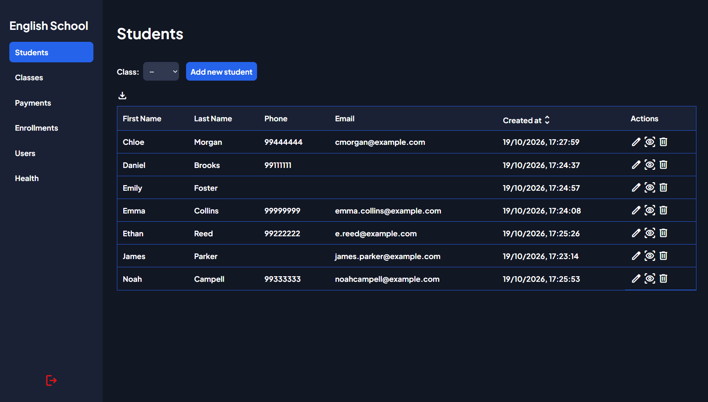
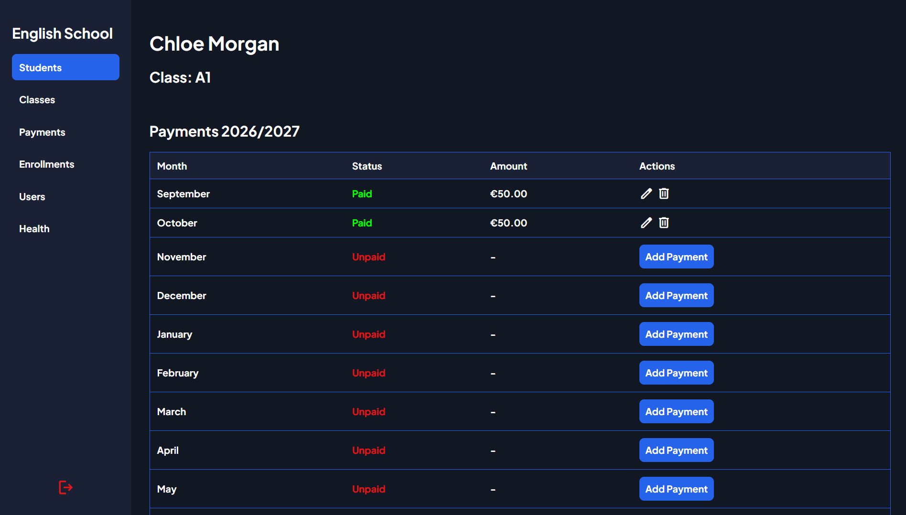
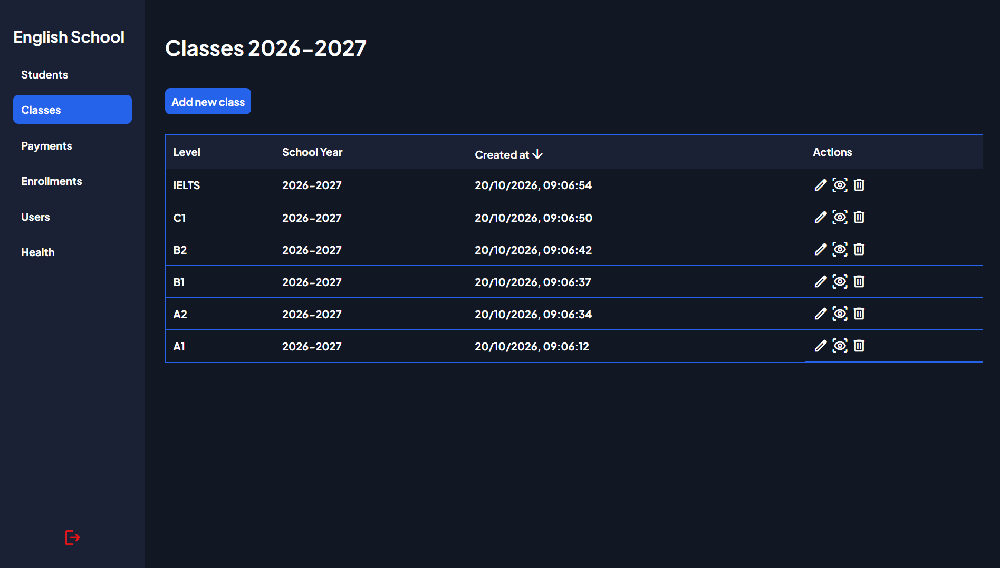
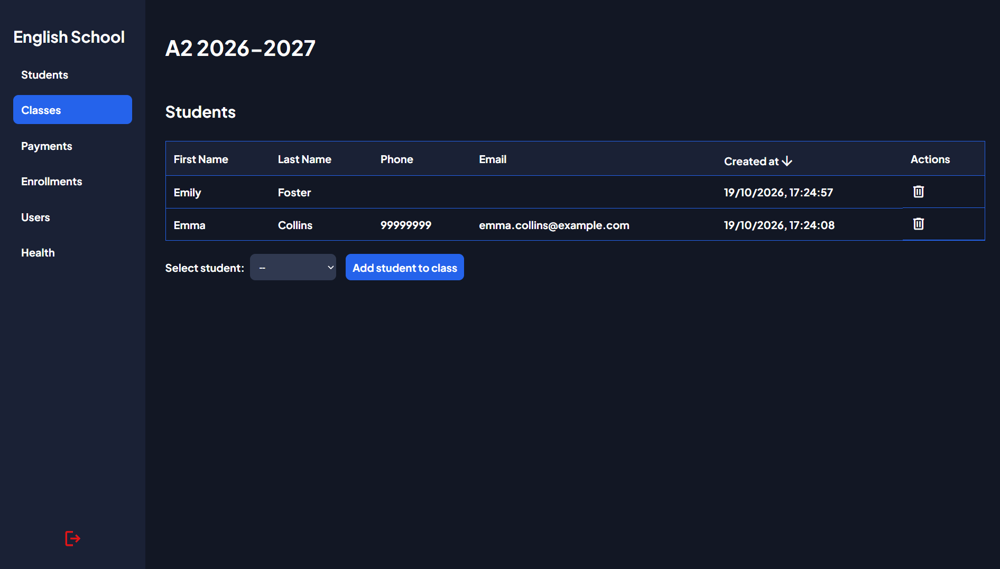
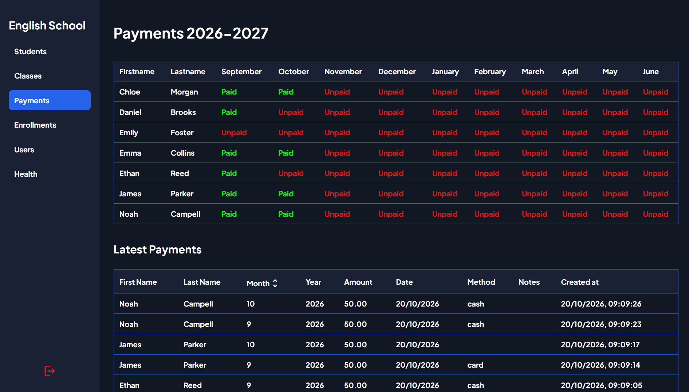
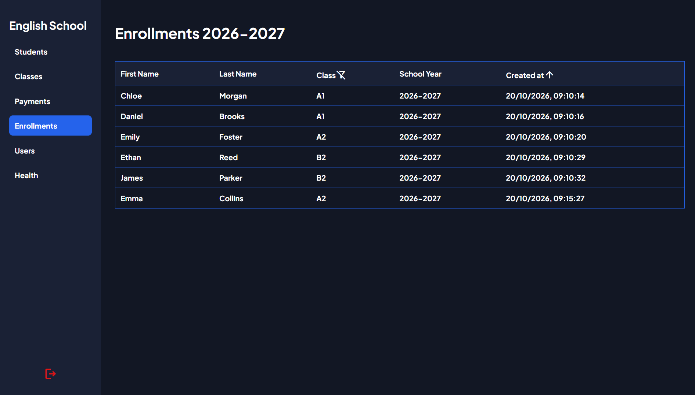
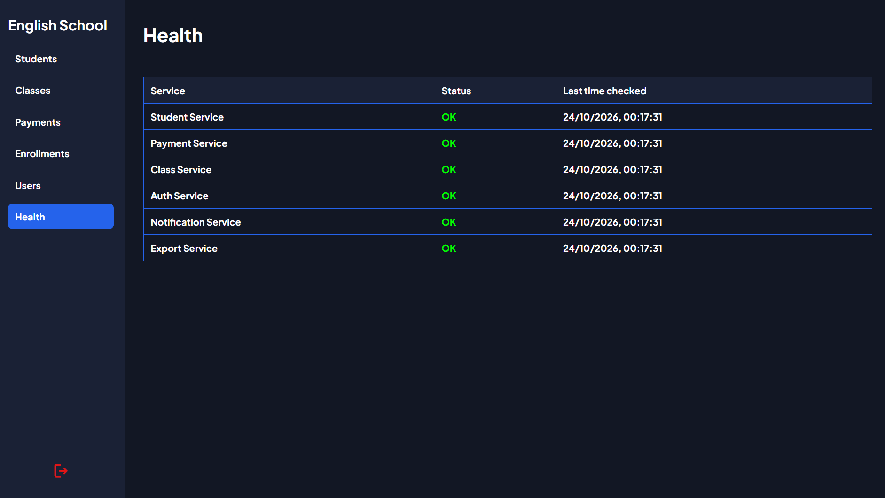
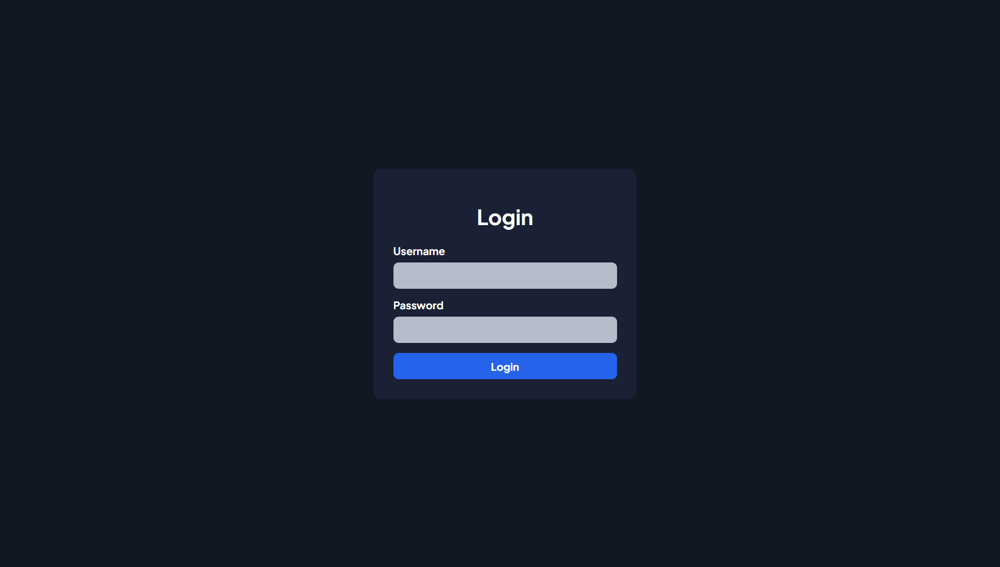

# English School Management System
A full-stack management system designed to support the daily operations of an English Institute. The application provides student, class, enrollment, payment and user management with role-based access for teachers and admins.

The system is built with React and Vite on the frontend, Node.js microservices on the backend and PostgreSQL for data persistence. Docker Compose orchestrates the application services in development and production enviroments.

## ✨ Features
- **🔐 User Authentication & Management**
- **👨🏻‍🎓 Student Management**
- **📚 Class & Enrollment Management**
- **💳 Payment Management**
- **📧 Payment Confirmation Emails**
- **📄 PDF Export**

## 🔐 User Roles & Permissions

### 👨‍🏫 Teacher
Teachers can manage the core operations of institute:
- Student management
- Payment management
- Class and enrollment management

### 👨‍💻 Admin
Admins have access to teacher functionalities along with additional capabilities:
- User management
- Microservice health monitoring
- Access to additional monitoring information

Access to protected routes and administrative operations is controlled through JWT authentication and role-based authorization.

## 📸 Screenshots
| Student Management | Student Details |
| --- | --- |
|  |  |

| Class Management | Class Details |
| --- | --- |
|  |  |

| Payments | Enrollments |
| --- | --- |
|  |  |

| Health | Login |
| --- | --- |
|  |  |

## 🛠️ Tech Stack

### Frontend
- **React**
- **Vite**
- **CSS**

### Backend
- **Node.js**
- **Express**
- **Microservices Arhitecture**
- **API Gateway**

### Database
- **PostgreSQL**
- **pgAdmin**

### Additional Libraries & Tools
- **JWT** - Authentication & Authorization
- **Joi** - Validation
- **bcrypt** - Password hashing
- **Nodemailer** - Email notifications
- **pdfmake** - PDF document generation
- **Docker** - Containerization
- **Nginx** - Reverse proxy for frontend and API request routing.
- **Postman** - API endpoints testing

## 🧩 System Architecture
The application follows a microservices architecture, with Nginx acting as a reverse proxy for the frontend and API Gateway. The API Gateway forwards requests to the appropriate backend services.

## Microservices Overview
- **Authentication Service**: Handles user registration, login, user management and JWT generation upon login.
- **Student Service:** Manages student records.
- **Class Service:** Manages classes and student enrollments.
- **Payment Service:** Manages payment records and tracks student payments.
- **Notification Service:** Sends payment confirmation emails.
- **Export Service:** Exports given data to PDF files.

## 📁 Project Structure
```text
english-school-management/
├── frontend/
│   ├── src/
│   │   ├── config/
│   │   ├── pages/
│   │   ├── components/
│   │   ├── services/
│   │   └── utils/
│   ├── Dockerfile.dev
│   └── Dockerfile.prod
├── api_gateway/
│   ├── src/
│   │   ├── config/
│   │   ├── middleware/
│   │   ├── routes/
│   │   ├── controllers/
│   │   └── app.js
│   ├── Dockerfile.dev
│   ├── Dockerfile.prod
│   └── .env.example
├── student_service/
│   ├── src/
│   │   ├── config/
│   │   ├── routes/
│   │   ├── controllers/
│   │   ├── schemas/
│   │   ├── repositories/
│   │   └── app.js
│   ├── Dockerfile.dev
│   ├── Dockerfile.prod
│   └── .env.example
├── payment_service/
├── class_service/
├── export_service/
├── notification_service/
├── auth_service/
├── database/
├── scripts/
├── screenshots/
├── nginx/
├── docker-compose.dev.yml
├── docker-compose.prod.yml
├── .env.example
└── README.md
```

- `config/` - Contains service configuration and database connection setup.
- `middleware/` - Handles JWT authentication and role-based authorization.
- `routes/` - Defines API endpoints.
- `controllers/` - Handles requests processing and responses.
- `schemas/` - Defines Joi schemas.
- `repositories/` - Contains database access logic and SQL queries.
- `app.js` - Initializes and configures the application.

## 🚀 Getting Started

### ⚙️ Prerequisites
- **Git**
- **Docker Desktop**
- **pgAdmin**
- **Postman**

Make sure **Docker Desktop** is running.

### Clone the Repository
Open a terminal and run the following commands to clone the repository and navigate to the project directory:
```bash
git clone https://github.com/evamvatsoulis/english-school-management.git

cd english-school-management
```

### Enviroment Configuration
The application uses enviroment variables for service configuration.

Before starting the application:

1. Create a `.env` file in the project root directory based on `.env.example` and configure the required enviroment variables (Docker initializes the database using the credentials configured through the root `.env` file).
2. Repeat the same process for each service that requires its own `.env` file.
3. Verify that database connection settings match the root `.env` file credentials.

### Database Initialization
1. From the project root directory, run the following command to build and start the application in **development** mode:
```bash
docker compose -f docker-compose.dev.yml up -d --build
```
2. Connect to the database using **pgAdmin**.
3. Execute the SQL script located at `database/init.sql` to create the required tables and unique constraints.

### User initialization
After initializing the database schema, an initial user must be created manually to access the application.

1. Make sure the application is running in **development** mode.
2. Open **Postman** and create a new **POST** request.
3. Enter the registration endpoint URL: `localhost:3002/register`.
4. Under body select **raw** and choose **JSON**.
5. Enter the registration data in the following format:
```json
{
    "username": "your_username",
    "password": "your_password",
    "role": "your_role"
}
```
6. Click **Send** to submit the request.

Once registration is successful, you can start the application and log in using your credentials.

### ▶️ Starting the Application

#### Development
Build and start the application in **development** mode:
```bash
docker compose -f docker-compose.dev.yml up -d --build
```

#### Production
Build and start the application in **production** mode:
```bash
docker compose -f docker-compose.prod.yml up -d --build
```

Once the build is complete and the containers are running, open the application in your browser: `http://localhost`

### ⏹️ Stopping the Application
Stop the development enviroment:
```bash
docker compose -f docker-compose.dev.yml down
```

Stop the production enviroment:
```bash
docker compose -f docker-compose.prod.yml down
```

## 📡 API Endpoints
The following endpoints are exposed through the API Gateway and accessed via the Nginx reverse proxy using the `/api` prefix.

### User Authentication & Management
| Method | Endpoint | Description |
| --- | --- | --- |
| GET | `/auth/users` | Retrieves all users |
| POST | `/auth/login` | Authenticates a user and returns an authentication token upon successful login |
| POST | `/auth/register` | Creates a new user |
| PATCH | `/auth/users/:id` | Updates an existing user's information |
| DELETE | `/auth/users/:id` | Deletes a user |

### Student Management
| Method | Endpoint | Description |
| --- | --- | --- |
| GET | `/students` | Retrieves all students |
| GET | `/students/:id` | Retrieves a student by ID |
| POST | `/students` | Creates a new student |
| POST | `/students/batch` | Retrieves multiple students by their IDs |
| PATCH | `/students/:id `| Updates an existing student's information |
| PATCH | `/students/:id/deactivate` | Deactivates a student|

### Payment Management
| Method | Endpoint | Description |
| --- | --- | --- |
| GET | `/payments` | Retrieves all payments |
| GET | `/payments/:id` | Retrieves a payment by ID |
| GET | `/payments/students/:studentId` | Retrieves all payments for a specific student |
| POST | `/payments` | Creates a new payment |
| PATCH | `/payments/:id` | Updates an existing payment's information |
| DELETE | `/payments/:id` | Deletes a payment |

### Class & Enrollment Management

#### Class Management
| Method | Endpoint | Description |
| --- | --- | --- |
| GET | `/classes` | Retrieves all classes |
| GET | `/classes/:id` | Retrieves a class by ID |
| POST | `/classes` | Creates a new class |
| PATCH | `/classes/:id` | Updates an existing class's information |
| PATCH | `/classes/:id/deactivate` | Deactivates a class |

#### Enrollment Management
| Method | Endpoint | Description |
| --- | --- | --- |
| GET | `/enrollments` | Retrieves all enrollments |
| GET | `/enrollments/class/:classId` | Retrieves all enrollments for a specific class |
| GET | `/enrollments/student/:studentId` | Retrieves all enrollments for a specific student |
| POST | `/enrollments` | Creates a new enrollment |
| DELETE | `/enrollments/class/:classId/student/:studentId` | Deletes an enrollment |

### PDF Export
| Method | Endpoint | Description |
| --- | --- | --- |
| POST | `/export/pdf` | Exports given data to a PDF file |

### Health Checks
| Method | Endpoint | Description |
| --- | --- | --- |
| GET | `/health` | Retrieves the health status of all microservices |

### Internal Service Endpoints

#### Notification Service
| Method | Endpoint | Description |
| --- | --- | --- |
| POST | `/notification/email` | Sends payment confirmation email |

## 🗄️ Database Backup
A sample Windows batch script is provided in `scripts/backup.example.bat` to help create backups of the PostgreSQL database.

1. Configure the required database connection details and backup destination in the script.
2. Run the script to create a database backup.

Backups are not created automatically.

## 🧑🏻‍💻 Author
**Emmanuel Vamvatsoulis**
- **Github:** [Github Profile](https://github.com/evamvatsoulis)
- **LinkedIn:** [LinkedIn Profile](https://www.linkedin.com/in/emmanuel-vamvatsoulis/)

## 📄 License
All rights reserved. The source code is provided for viewing purposes only. No permission is granted for its use, reproduction, modification, or distribution without prior written authorization from the copyright holder.